<div align="center">


# SnapForge

### Capture, annotate and record your screen. Fast, native, and free.

A lightweight Windows screen capture, annotation and recording tool written in **Rust**.
It ships as a single 11.5 MB EXE with no runtimes, no account, no cloud and no telemetry.

<p>
  
  
  
  
</p>

<p>
  
  
  
  
  
</p>

[**Features**](#-features) ·
[**Screenshots**](#%EF%B8%8F-screenshots) ·
[**Performance**](#-performance) ·
[**Hotkeys**](#%EF%B8%8F-default-hotkeys) ·
[**Build**](#%EF%B8%8F-build-from-source) ·
[**Architecture**](#-architecture) ·
[**Developer**](#-developer)

</div>

---

## ✨ Why SnapForge?

<table>
<tr>
<td width="33%" valign="top">

### ⚡ Fast
SnapForge is ready in the tray about **0.2 s** after launch and uses **17 MB** of RAM while idle. A hotkey brings up the capture overlay in **36 ms**. The editor is created once, then hidden and reused, so after the first time it opens instantly.

</td>
<td width="33%" valign="top">

### 🎯 Simple
Every action takes one hotkey or 1–2 clicks. The defaults work without any setup and there is no sign-up. Advanced options sit under **More…**, and **Ctrl+K** searches every command.

</td>
<td width="33%" valign="top">

### 📦 Standalone
One self-contained `SnapForge.exe` with a static CRT. It needs no .NET, no VC++ redistributable and no FFmpeg DLLs. Run it portable, or install it per user without admin rights.

</td>
</tr>
</table>

## 🧰 Features

| | Area | Highlights |
|:-:|---|---|
| 🖼️ | **Capture** | **Modes:** active window · window/object with hover highlight, Ctrl multi-select and nested UI elements · rectangle with an 8× magnifier loupe, Tab corner switch and 1 px nudges · freehand · full screen (active or all monitors) · scrolling (vertical, horizontal or both, with sticky-header detection) · fixed-size presets<br>**Helpers:** repeat last capture · countdown delay · auto capture at an interval · tiny 1×1 captures |
| 🎮 | **Capture engine** | Windows.Graphics.Capture (games, DirectX, **HDR tone-mapped to SDR**, borderless), DXGI Desktop Duplication, and GDI. The fastest reliable engine is chosen automatically. |
| 📤 | **Output** | Editor · Draw · clipboard (with alpha) · file (PNG/JPG/BMP/GIF/TIFF/TGA/PCX/WebP) · printer · email (MAPI) · Word/Excel/PowerPoint (COM) · OneNote · FTP/SFTP · external program · date/time stamp · templated file names |
| ✏️ | **Editor** | **Workspace:** tabs and workspaces · unlimited, memory-aware undo · command palette (Ctrl+K)<br>**Editing:** crop, resize, rotate, flip, canvas size · selections (move, copy, statistics) · edge drag to trim or extend · clone stamp · remove/insert strip · transparent background<br>**More:** scanner (WIA, with deskew) · Edit With … |
| 🎨 | **Effects** | Blur, sharpen, pixelate, color adjust, sepia, negative, 256/16/4/2-color reduction, spotlight, drop shadow, frame, torn edge, fade edge, reflection, watermark, caption, oil paint, sketch, all with live preview |
| 🖌️ | **Annotations** | **Text:** straight, curved or along a path, with shadow, outline and callouts<br>**Lines:** arrows (8 heads, 10 decorative styles), curves, polylines, L-lines<br>**Shapes and marks:** shapes, brackets, highlighters, magnifier callouts, step stamps 0–999, color emoji, 3D arrows, mouse pointers<br>**Pixel tools:** blur, pixelate, eraser, fill, pencil<br>Annotations stay editable in `.sfcap` projects. |
| 🎬 | **Recorder** | Hardware H.264/AAC MP4, WMV, MP3 · microphone and system audio mixed · webcam picture-in-picture · click highlights and sounds · F5 live zoom · pause/resume · scheduled recording · **crash-safe fragmented MP4** |
| 🎞️ | **Video editor** | Timeline with thumbnails and waveform · trim and cut · frame stepping · timed annotations · zoom & pan keyframes · title cards · save frame · MP4 and **animated GIF** export · `.sfvid` projects |
| 📌 | **Pin & OCR** | Pin captures as always-on-top windows (zoom, opacity, draw mode) · Capture Text with Windows OCR (tiling for images over 10 000 px) |
| 🧪 | **Screen tools** | Color picker (HEX/RGB/decimal, recent colors) · magnifier · crosshair · focus spotlight · calibrated ruler with protractor |
| 🧾 | **Tools** | Combine images · convert images to a multi-page PDF · batch print with headers and footers |
| 🤖 | **Automation** | `SnapForge.exe --capture region --out clipboard`, single-instance forwarding, `--bench` |

## 🖼️ Screenshots

<table>
<tr>
<td colspan="2" align="center"><b>Editor with draw tools</b><br>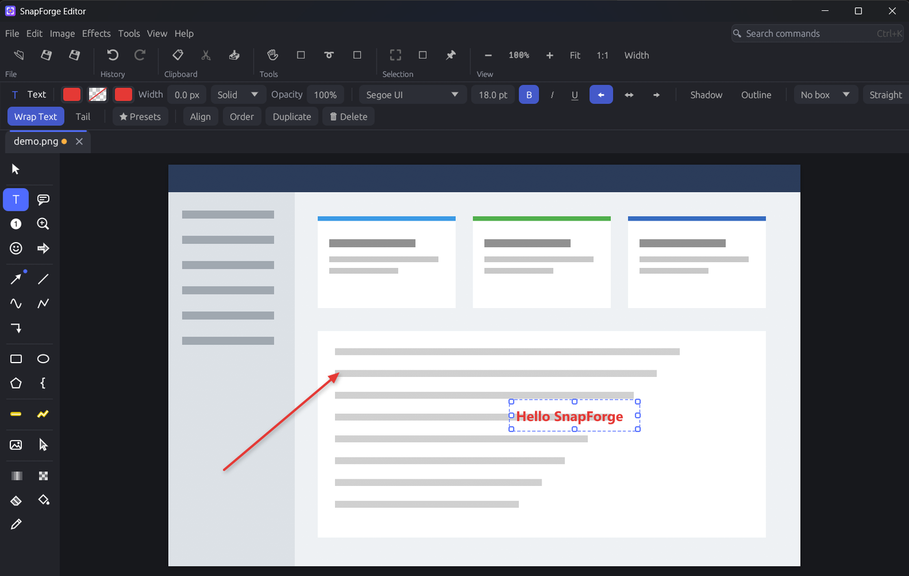</td>
</tr>
<tr>
<td width="50%" align="center"><b>Effects with live preview</b><br>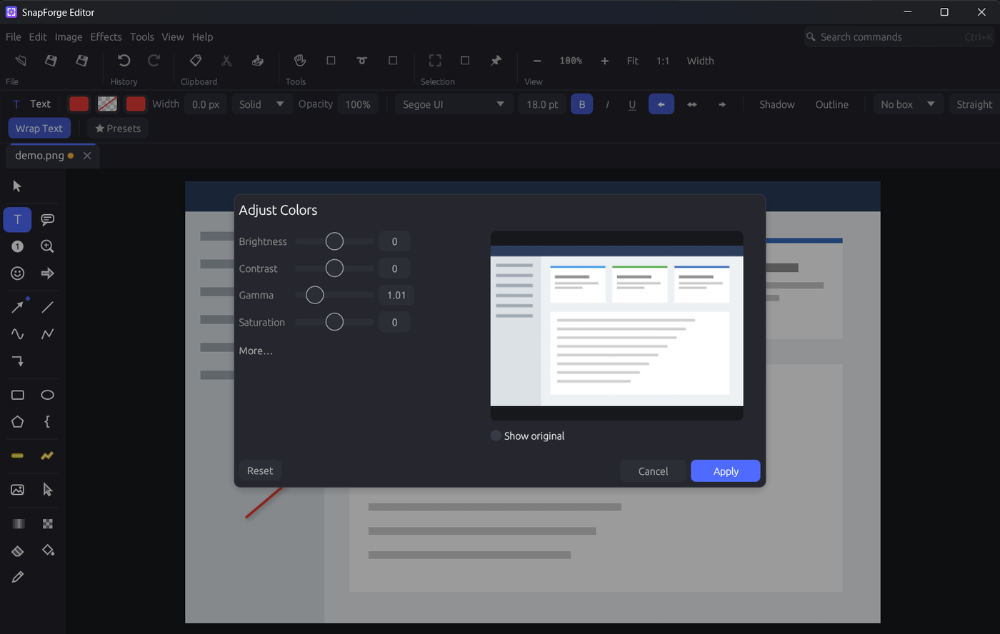</td>
<td width="50%" align="center"><b>Video editor</b><br>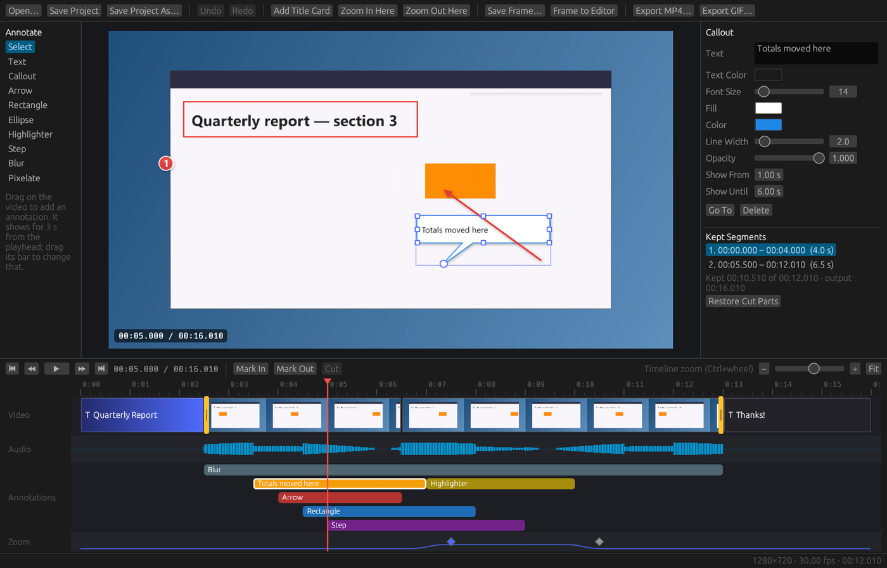</td>
</tr>
<tr>
<td colspan="2" align="center"><b>Annotation objects</b><br>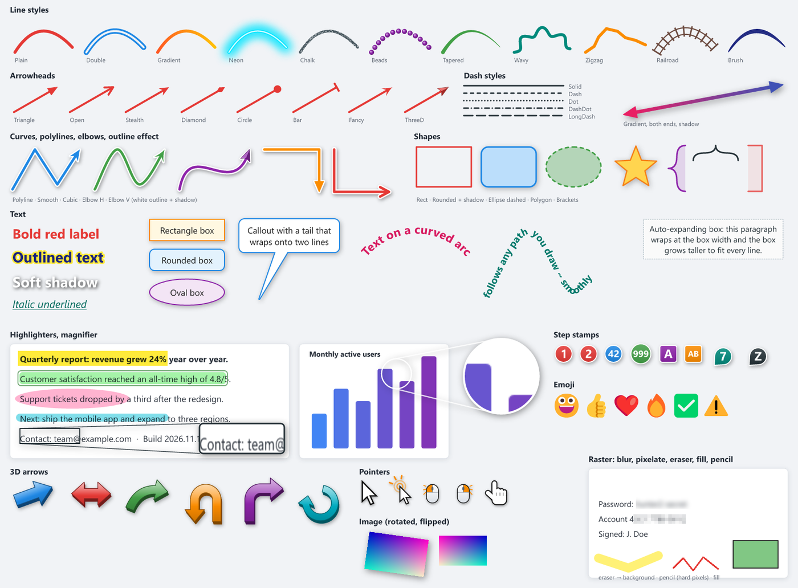</td>
</tr>
<tr>
<td width="50%" align="center"><b>Settings</b><br>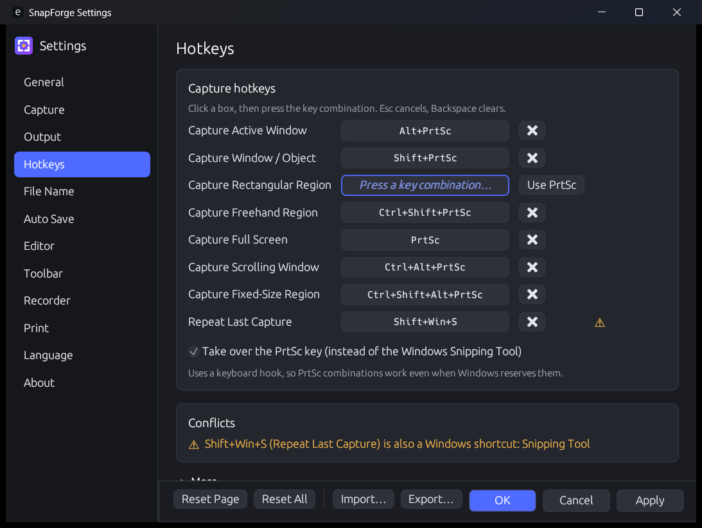</td>
<td width="50%" align="center"><b>Capture toolbar (light, dark, big buttons)</b><br>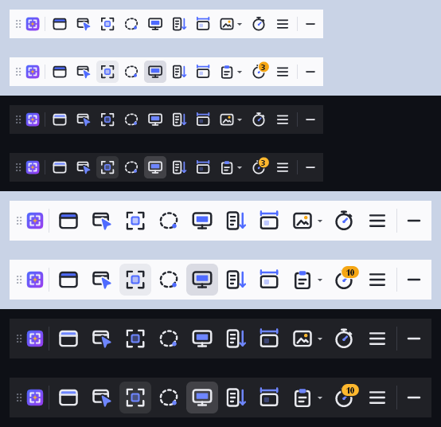</td>
</tr>
<tr>
<td width="50%" align="center"><b>Capture Text (OCR)</b><br>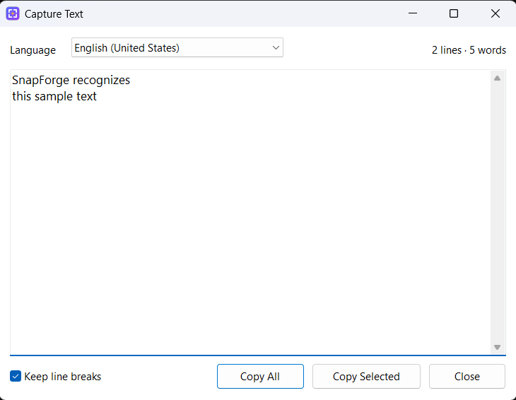</td>
<td width="50%" align="center"><b>Color picker</b><br>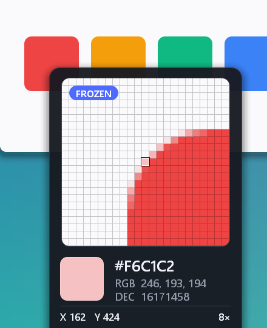</td>
</tr>
<tr>
<td width="50%" align="center"><b>Pin to screen in draw mode</b><br>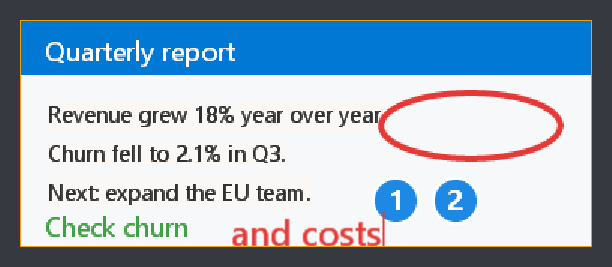</td>
<td width="50%" align="center"><b>Screen ruler</b><br>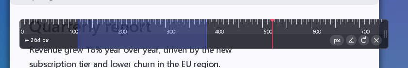</td>
</tr>
<tr>
<td width="50%" align="center"><b>Convert to MP4</b><br>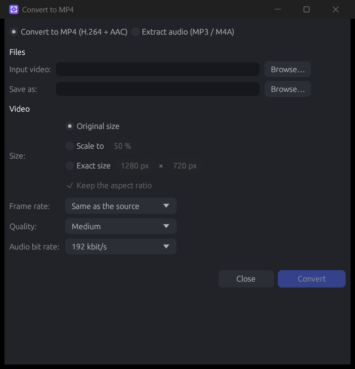</td>
<td width="50%" align="center"><b>Magnifier</b><br>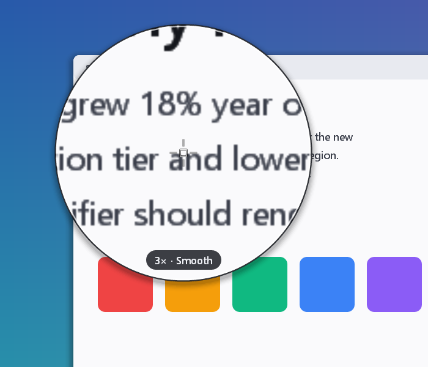</td>
</tr>
</table>

## 🚀 Performance

These numbers were measured with `SnapForge.exe --bench` on a release build (i7-13620H, Windows 11):

| Budget | Target | Measured |
|---|---|---|
| Cold start → tray ready | < 300 ms | ✅ **184 ms** |
| Idle RAM in the tray | < 30 MB | ✅ **17 MB** working set |
| Hotkey → capture overlay visible | < 80 ms | ✅ **36 ms** |
| Capture → editor showing the image | < 150 ms | ✅ **31 ms** (first open 327 ms, which includes OpenGL start-up) |
| Portable EXE size | < 20 MB | ✅ **11.5 MB** |
| 1080p60 recording, hardware encoder | < 10 % CPU, no drops | ✅ **1.3 % of total CPU, 0 of 330 frames dropped** |
| 20-screen scrolling stitch | < 5 s | ✅ **90 ms** of stitching (plus scroll settle time) |
| A/V sync after 10 s of recording | < 40 ms drift | ✅ **14.7 ms** |

## ⌨️ Default hotkeys

| Action | Hotkey |
|---|---|
| 🖥️ Full screen | <kbd>PrtSc</kbd> |
| 🪟 Active window | <kbd>Alt</kbd> + <kbd>PrtSc</kbd> |
| 🎯 Window / object | <kbd>Shift</kbd> + <kbd>PrtSc</kbd> |
| ⬚ Rectangle region | <kbd>Ctrl</kbd> + <kbd>PrtSc</kbd> |
| ✍️ Freehand region | <kbd>Ctrl</kbd> + <kbd>Shift</kbd> + <kbd>PrtSc</kbd> |
| 📜 Scrolling window | <kbd>Ctrl</kbd> + <kbd>Alt</kbd> + <kbd>PrtSc</kbd> |
| 📐 Fixed-size region | <kbd>Ctrl</kbd> + <kbd>Shift</kbd> + <kbd>Alt</kbd> + <kbd>PrtSc</kbd> |

You can reassign every hotkey in **Settings → Hotkeys**, which also detects conflicts. Recording, OCR, pinning and the screen tools have optional hotkeys too. The full guide is in [`docs/USAGE.md`](docs/USAGE.md).

## 🛠️ Build from source

You need **Rust stable** (MSVC toolchain) and the **Visual Studio Build Tools** with the Windows 10/11 SDK.

```powershell
git clone https://github.com/zheerkhalid/snapforge.git
cd snapforge
cargo build --release                     # → target\release\SnapForge.exe
cargo test                                # unit and golden-image tests
cargo test -- --ignored --test-threads=1  # hardware tests (recording, OCR, live windows)
.\target\release\SnapForge.exe --bench    # prints the performance budgets
powershell -File scripts\package.ps1      # portable ZIP + SnapForge-Setup.exe (Inno Setup 6)
```

> [!TIP]
> To run in **portable mode**, create an empty `portable.flag` file next to `SnapForge.exe`. Settings are then stored beside the EXE instead of in `%APPDATA%\SnapForge`. The portable ZIP already includes this file.

## 🏗️ Architecture

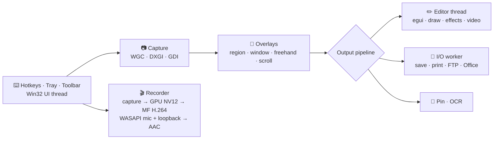

* **Threads:**
  * The **UI thread** (tray, toolbar, overlays) never blocks on disk, network or encoding.
  * The **editor** runs eframe on its own thread, created on first use and then hidden and reused.
  * The **recorder** uses separate capture, audio and encoder threads joined by bounded channels.
* **Data:** images are premultiplied BGRA. Annotations are a separate vector list and are flattened only on export. Projects are saved as `.sfcap` (a zip of the original PNG, the annotation JSON and metadata).
* **Modules:** `capture/` · `overlay/` · `editor/` · `draw/` · `effects/` · `compose/` · `recorder/` · `video_editor/` · `ocr/` · `pin/` · `tools/` · `output/` · `settings/` · `settings_ui/` · `hotkeys/` · `tray/` · `toolbar/`

The milestone checklist is in [`PLAN.md`](PLAN.md), and every judgment call is explained in [`DECISIONS.md`](DECISIONS.md).

## 👨‍💻 Developer

<table>
<tr>
<td align="center" width="140">
  <a href="https://zheer.dev">
    
  </a>
</td>
<td>

**Designed and developed by [Zheer Khalid](https://zheer.dev)**

🌐 Website: **[zheer.dev](https://zheer.dev)**  
🐙 GitHub: **[@zheerkhalid](https://github.com/zheerkhalid)**

If SnapForge saves you time, a ⭐ on the repo is appreciated.

</td>
</tr>
</table>

## 📄 License

MIT © 2026 [Zheer Khalid](https://zheer.dev). See [`LICENSE`](LICENSE).

<div align="center">
<sub>Built with 🦀 Rust and ❤️ by <a href="https://zheer.dev">zheer.dev</a></sub>
</div>
