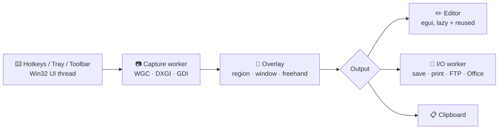

<div align="center">


# SnapForge

### Capture, annotate and record your screen. Fast, native, and free.

A lightweight Windows screen capture, annotation and recording tool written in **Rust**.
It ships as one EXE with no runtime dependencies, no account, no cloud and no telemetry.

<p>
  
  
  
  
</p>

<p>
  
  
  
  
</p>

[**Features**](#-features) ·
[**Hotkeys**](#%EF%B8%8F-default-hotkeys) ·
[**Build**](#%EF%B8%8F-build-from-source) ·
[**Architecture**](#-architecture) ·
[**Roadmap**](#%EF%B8%8F-roadmap) ·
[**Developer**](#-developer)

</div>

---

## ✨ Why SnapForge?

<table>
<tr>
<td width="33%" valign="top">

### ⚡ Fast
Pressing a hotkey shows the capture overlay almost immediately, and the tray app uses very little memory while idle. The editor is created once, then hidden and reused, so it opens instantly after the first time.

</td>
<td width="33%" valign="top">

### 🎯 Simple
Every action takes one hotkey or 1–2 clicks. The defaults work out of the box, with no setup wizard and no sign-up. Advanced options stay under **More…**.

</td>
<td width="33%" valign="top">

### 📦 Standalone
One self-contained `SnapForge.exe`. It needs no .NET, no VC++ redistributable and no FFmpeg DLLs. It can run portable or be installed per user without admin rights.

</td>
</tr>
</table>

## 🧰 Features

| | Area | Highlights |
|:-:|---|---|
| 🖼️ | **Capture modes** | Active window · window/object with hover highlight and Ctrl multi-select · rectangle with magnifier loupe · freehand · full screen (active or all monitors) · scrolling (auto-stitch) · fixed-size presets |
| 🎮 | **Modern capture engine** | Windows.Graphics.Capture first (games, DirectX, HDR → SDR), then DXGI Desktop Duplication, then GDI |
| ⏱️ | **Capture helpers** | Repeat last capture · delay with on-screen countdown · auto-capture at an interval · tiny 1×1 captures |
| 📤 | **Output destinations** | Editor · clipboard · file (templated names) · printer · email · Word/Excel/PowerPoint/OneNote · FTP/SFTP · external program |
| 🏷️ | **File-name templates** | `$Y $M $D $H $N $S` · `###` counters with daily reset · `@` random characters · `%USERNAME%` `%DESKTOP%` … |
| ✏️ | **Editor** *(Phase 2)* | Tabs, unlimited undo, crop/resize/rotate, effects (shadow, torn edge, spotlight…), command palette (Ctrl+K) |
| 🖌️ | **Annotations** *(Phase 3)* | Text, arrows, shapes, highlighters, step numbers, blur/pixelate, magnifier callouts; stays editable in `.sfcap` projects |
| 🎬 | **Recorder** *(Phase 4)* | Hardware H.264 MP4, system and mic audio, webcam PiP, click highlights, crash-safe segments, video editor, GIF export |
| 📌 | **Pin & tools** *(Phase 5)* | Pin to screen · OCR (Windows.Media.Ocr) · color picker · magnifier · crosshair · focus · ruler |
| 🤖 | **Automation** | `SnapForge.exe --capture region --out clipboard` and more |

## ⌨️ Default hotkeys

| Action | Hotkey |
|---|---|
| 🖥️ Full screen | <kbd>PrtSc</kbd> |
| 🪟 Active window | <kbd>Alt</kbd> + <kbd>PrtSc</kbd> |
| 🎯 Window / object | <kbd>Shift</kbd> + <kbd>PrtSc</kbd> |
| ⬚ Rectangle region | <kbd>Ctrl</kbd> + <kbd>PrtSc</kbd> |
| ✍️ Freehand region | <kbd>Ctrl</kbd> + <kbd>Shift</kbd> + <kbd>PrtSc</kbd> |
| 📜 Scrolling window | <kbd>Ctrl</kbd> + <kbd>Alt</kbd> + <kbd>PrtSc</kbd> |
| 📐 Fixed-size region | <kbd>Ctrl</kbd> + <kbd>Shift</kbd> + <kbd>Alt</kbd> + <kbd>PrtSc</kbd> |

You can reassign every hotkey. The full guide is in [`docs/USAGE.md`](docs/USAGE.md).

## 🛠️ Build from source

You need **Rust stable** (MSVC toolchain) and the **Visual Studio Build Tools** with the Windows 10/11 SDK.

```powershell
git clone https://github.com/zheerkhalid/snapforge.git
cd snapforge
cargo build --release          # → target\release\SnapForge.exe
cargo test                     # unit and golden-image tests
.\target\release\SnapForge.exe --bench   # prints the performance budgets
```

> [!TIP]
> To run in **portable mode**, create an empty `portable.flag` file next to `SnapForge.exe`. Settings are then stored beside the EXE instead of in `%APPDATA%\SnapForge`.

## 🏗️ Architecture



* **One process, several threads:** a UI thread, a capture worker, an I/O worker, and the recording pipeline (Phase 4). The UI thread never blocks on disk, network or encoding.
* **Images** are premultiplied BGRA buffers. **Annotations** are a separate vector list and are flattened only on export.
* **Modules:** `capture/` · `overlay/` · `editor/` · `draw/` · `effects/` · `recorder/` · `video_editor/` · `ocr/` · `pin/` · `tools/` · `output/` · `settings/` · `hotkeys/` · `tray/`

The milestone checklist is in [`PLAN.md`](PLAN.md), and every judgment call is explained in [`DECISIONS.md`](DECISIONS.md).

## 🗺️ Roadmap

- [ ] **Phase 1:** core capture, toolbar, hotkeys, outputs, file naming *(in progress)*
- [ ] **Phase 2:** editor (tabs, image operations, effects, Tools menu, PDF)
- [ ] **Phase 3:** draw / annotation toolset
- [ ] **Phase 4:** screen recorder and video editor
- [ ] **Phase 5:** pin to screen, OCR, screen tools
- [ ] **Phase 6:** settings UI, localization, accessibility, installer

## 👨‍💻 Developer

<table>
<tr>
<td align="center" width="140">
  <a href="https://zheer.dev">
    
  </a>
</td>
<td>

**Designed and developed by [Zheer Khalid](https://zheer.dev)**

🌐 Website: **[zheer.dev](https://zheer.dev)**  
🐙 GitHub: **[@zheerkhalid](https://github.com/zheerkhalid)**

If SnapForge saves you time, a ⭐ on the repo is appreciated.

</td>
</tr>
</table>

## 📄 License

MIT © 2026 [Zheer Khalid](https://zheer.dev). See [`LICENSE`](LICENSE).

<div align="center">
<sub>Built with 🦀 Rust and ❤️ by <a href="https://zheer.dev">zheer.dev</a></sub>
</div>
